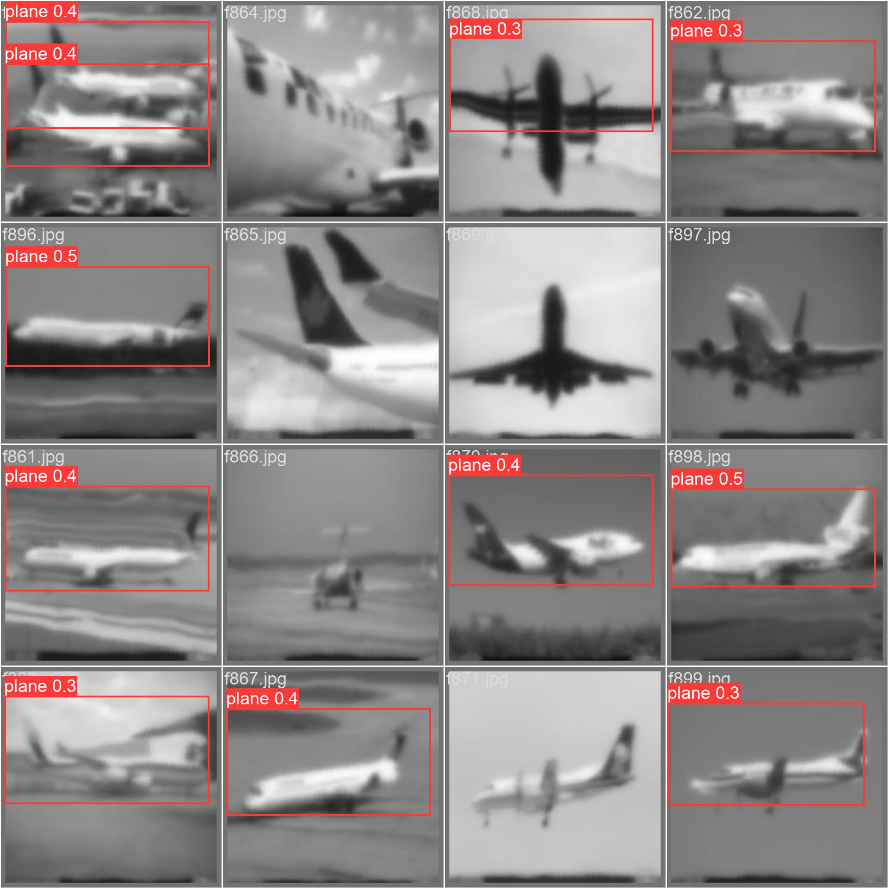
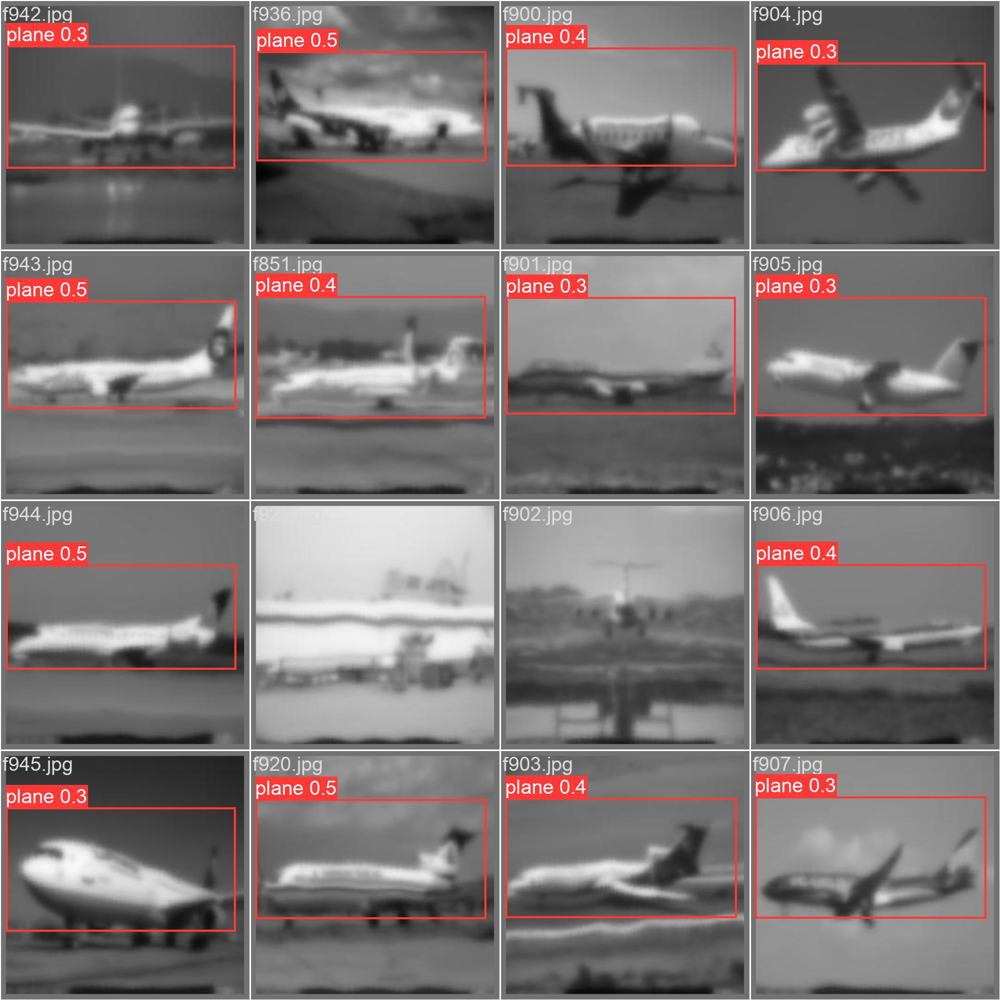

# Blurred Image Detection with YOLOv8

Can an object detector learn to find objects in **turbulence-blurred** images as well as in sharp ones, so a slow deblurring network doesn't have to run first?

This project trains **YOLOv8** to detect aeroplanes in images degraded by a physics-based atmospheric turbulence simulator. Detection then runs directly on the blurred frames, with no separate deblurring step.

📄 **Full report:** [report/Blurred_Image_Detection_with_YOLOv8.pdf](report/Blurred_Image_Detection_with_YOLOv8.pdf)



---

## Motivation

Image quality strongly affects computer vision results. A small amount of blur or a few artifacts can change a detector's output completely. Restoration networks such as **DeblurGAN** (blur) and **SwinIR** (noise) clean images well, but they can take seconds per frame. Real-time uses such as autonomous driving need about **24 fps or more**, so a separate restoration step is too slow.

The idea here is to skip that step and **train the detector itself to cope with blur**.

## Method

1. **Baseline (OD\*)**: run YOLOv8 on the clean images. It detects the object class (aeroplanes) well, and these detections serve as labels.
2. **Degrade**: pass the same images through the turbulence simulator to make blurred copies.
3. **Blurred baseline (OD−)**: the stock detector does poorly on the blurred images.
4. **Retrain (YOLOv8 #)**: train YOLOv8 on the blurred images, using the labels from the clean images in step 1, so the losses teach the network what blurred planes look like.
5. **Validate (OD+)**: in theory, results on blurred images should now approach the clean baseline OD\*.

Aeroplanes were chosen as the object of interest. The same pipeline works for any class.

### Turbulence generator

The blurred dataset was made with the simulator from Chimitt & Chan, *"Simulating Anisoplanatic Turbulence by Sampling Inter-modal and Spatially Correlated Zernike Coefficients"* (2020). It draws Zernike coefficients with inter-modal and spatial correlations, and it:

- **separates tilts from higher-order aberrations**. Tilts carry most of the distortion energy, so the blur PSFs can be handled more cheaply.
- **keeps tilts spatially correlated** across the image without slowing the simulation.

About **1,000 blurred images** were generated with it and used as the project dataset.

## Results

Training run from [`notebooks/train_yolov8.ipynb`](notebooks/train_yolov8.ipynb): YOLOv8n built from scratch (`yolov8n.yaml`), 5 epochs, 640 px input, Ultralytics 8.0.115.

| Validation set | Precision | Recall | mAP@50 | mAP@50-95 |
|---|---|---|---|---|
| 190 blurred images, 254 planes | **0.796** | **0.579** | **0.642** | **0.266** |

- After training, the model **detects aeroplanes in blurred images**:



- **Limitation:** accuracy **dropped on sharp, high-quality images**, most likely because the model overfit to the blurred data. Future work is to train on a mix of sharp and blurred images so the detector handles both.

Precision–recall and confidence curves are in the [report](report/Blurred_Image_Detection_with_YOLOv8.pdf).

## Repository layout

```
.
├── report/
│   └── Blurred_Image_Detection_with_YOLOv8.pdf   # project report
├── notebooks/
│   ├── train_yolov8.ipynb                         # trains YOLOv8n on the blurred dataset (Colab)
│   └── generate_labels_and_predict.ipynb          # labels clean images with a pretrained model, runs YOLOv8 predictions
├── scripts/
│   └── preprocess_images.py                       # resize images and convert them to greyscale
├── turbulence_generator/                          # MATLAB turbulence simulator (Chimitt & Chan, BSD-3)
│   ├── demo.m                                     # entry point: blur one image
│   ├── sim_fun.m                                  # simulator
│   ├── dictionary1.mat, dictionary2.mat           # precomputed PSF dictionaries
│   └── license.txt
└── results/
    ├── val_batch1_pred.jpg                        # validation predictions
    └── val_batch2_pred.jpg
```

## How to reproduce

### 1. Make a blurred dataset (MATLAB)

```matlab
cd turbulence_generator
img = im2double(imread('your_image.png'));
if size(img,3) ~= 1, img = rgb2gray(img); end
img = imresize(img, [256 256]);

params.t_params.L = 10;          % propagation length (m); see sim_fun.m for all parameters
out = sim_fun(img, params);      % turbulence-degraded frame(s)
imwrite(out(:,:,1), 'blurred.png');
```

`demo.m` does the same for a single image. Point it at your own input, because the sample `./data/Pattern1_GT.png` it mentions is not included. Other parameters (`D`, `lambda`, `Cn2`, `d`, sampling settings) and their defaults are documented at the top of `sim_fun.m`.

### 2. Pre-process (Python)

```bash
pip install pillow
python scripts/preprocess_images.py   # edit the input/output folders at the bottom first
```

The script converts images to greyscale. A commented-out block above it resizes images to 256 × 256.

### 3. Train and validate YOLOv8

The notebooks were written for **Google Colab** with data on Google Drive. Update the paths to match your setup.

```bash
pip install ultralytics
```

```python
from ultralytics import YOLO

model = YOLO("yolov8n.yaml")                  # or "yolov8n.pt" to start from pretrained weights
model.train(data="data.yaml", epochs=5)
```

`data.yaml` should point to your blurred `train/` and `val/` folders (YOLO-format labels) and list one class, `plane`.

> The ~1,000-image blurred dataset and the trained `best.pt` weights are not included in this repository.

## Tech stack

YOLOv8 (Ultralytics) · YOLOv5 (labelling) · PyTorch · Python · Pillow · OpenCV · MATLAB · Google Colab

## Author

**Joy Mathew Gunasekar**, University of California, Riverside

## Acknowledgements and references

- `turbulence_generator/` is the work of **Nicholas Chimitt and Stanley H. Chan** (Purdue University), redistributed under its BSD-3-Clause licence ([license.txt](turbulence_generator/license.txt)). It bundles helpers by other authors, each with its original header: `ZernikeCalc.m` (Robert W. Gray and Joseph M. Howard) and `affine_fit.m` (Adrien Leygue). If you use the simulator, please cite:
  N. Chimitt and S. H. Chan, *"Simulating Anisoplanatic Turbulence by Sampling Inter-modal and Spatially Correlated Zernike Coefficients,"* arXiv:2004.11210, 2020.
- J. Redmon et al., *"You Only Look Once: Unified, Real-Time Object Detection,"* 2016.
- C.-Y. Wang, A. Bochkovskiy, H.-Y. M. Liao, *"YOLOv7: Trainable bag-of-freebies sets new state-of-the-art for real-time object detectors,"* 2022.
- O. Kupyn et al., *"DeblurGAN: Blind Motion Deblurring Using Conditional Adversarial Networks,"* 2018.
- J. Liang et al., *"SwinIR: Image Restoration Using Swin Transformer,"* 2021.
- R. Ravindran, M. J. Santora, M. M. Jamali, *"Multi-Object Detection and Tracking, Based on DNN, for Autonomous Vehicles: A Review,"* IEEE Sensors Journal 21(5).
- C. Yu et al., *"BiSeNet V2: Bilateral Network with Guided Aggregation for Real-time Semantic Segmentation,"* IJCV, 2021.
